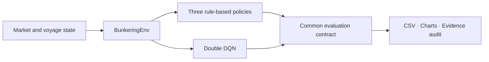
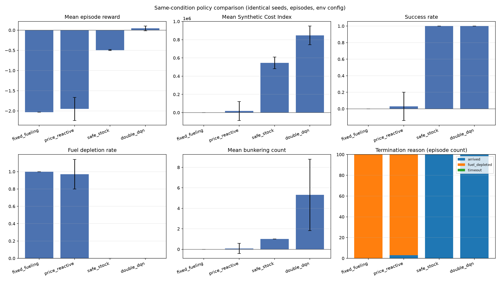
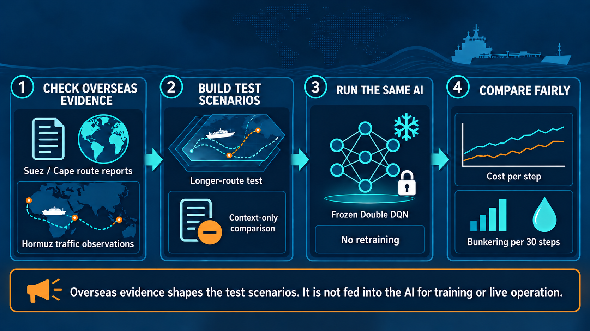
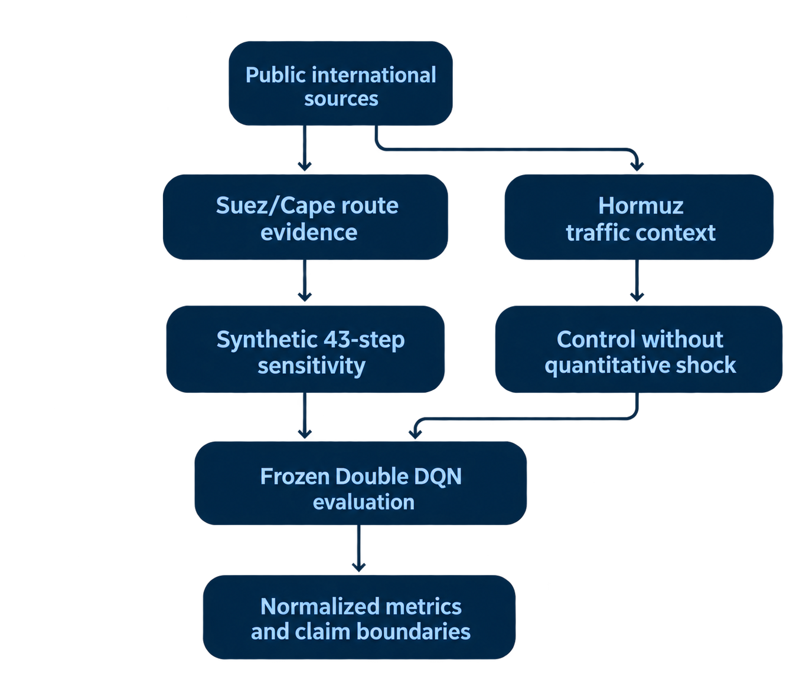
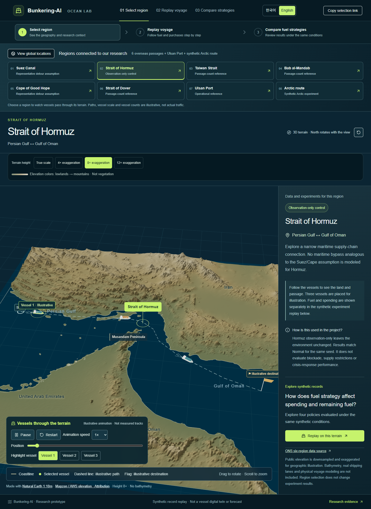
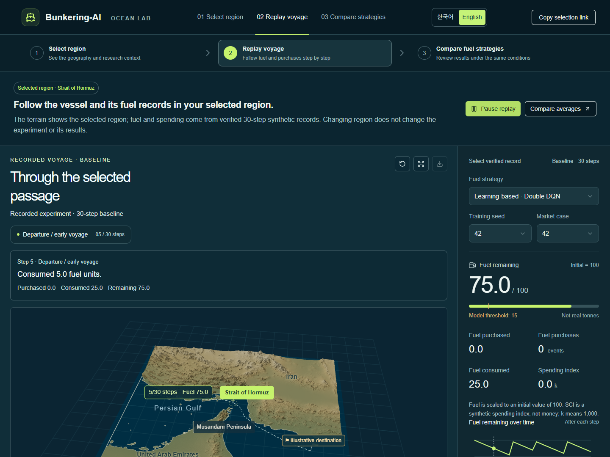
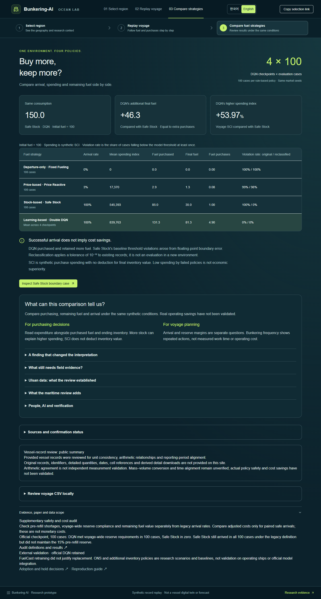

# Bunkering-AI

[한국어](README.md) | **English**

**A reproducible research project for sequential ship-refueling decisions.** Three rule-based policies and Double DQN are compared under identical synthetic voyage conditions. Purchases, consumption, terminal inventory, and source evidence are examined together.

[Ocean Lab demo](https://bunkering-ocean-lab.hc24734503.chatgpt.site/) · [Repository](https://github.com/heechan9/bunkering-ai) · [Quick start](#quick-start) · [Evidence and results](#evidence-and-results) · [Research boundaries](#research-boundaries)

> Research prototype. Synthetic results do not demonstrate real-vessel fuel savings, monetary savings, or operational safety certification. The official DQN remains unchanged.


*English-localized project artwork. Ships and market graphics illustrate the research theme; they are not operational records or evidence of realized savings.*


[](https://github.com/heechan9/bunkering-ai/actions/workflows/python-tests.yml)


The Python CI badge shows the current workflow status on main. The evidence-audit badge concerns eight consistency checks of official-result claims; it is not real-vessel performance validation. Historical counts apply only to the versions recorded: 514 tests and 23 subtests at the October 7 integration reviewed for #109; 288 tests in the earlier Windows record; 245 tests in the September 27 independent review. See [CI reproduction notes](docs/technical/python_ci.md), [#109 review record](https://github.com/heechan9/bunkering-ai/pull/109#issuecomment-6033647098), [earlier verification](docs/audits/local_verification_20261007.md), and [#66](https://github.com/heechan9/bunkering-ai/pull/66).

This English overview mirrors the images and all 13 tables of the [Korean README](README.md) at [`8ea74a9`](https://github.com/heechan9/bunkering-ai/tree/8ea74a952c9d0fd60875bde152c5196e81d3b8da). Many linked technical records are in Korean. The [visual correspondence and verification record](docs/audits/english_readme_visual_parity_20261015.md) documents the English artwork and actual public-demo captures.

## Current research and development status

This status snapshot was checked on October 13, 2026, when main was `2e00985` and PRs #113–#117 had merged. It is not a claim that this is the latest main commit. Incremental-time calculations, departure readiness, and intake validation were implemented and tested synthetically. Real-data validation and operational integration remain incomplete. The [Sites version 36 verification](docs/audits/ocean_lab_live_verification_20261007.md) is an October 7 record, separate from the English screenshot capture below. The manuscript was submitted; real-vessel validation, data collection, and project improvements continue.

<!-- TABLE 1: 30 data rows; counterpart of the Korean status table. -->
| Research/development stage | Status | Verified scope and remaining work |
|---|---|---|
| Incremental-time calculation and data-intake validation | Implemented on main (#114, #116) | Concurrent bunkering versus dedicated calls, departure readiness, UNKNOWN values, units, and time-order checks. A separate research tool, not connected to DQN decisions. [Guide](research/port_call_time/INTAKE.md) |
| Manuscript submission | Submission confirmed | The user confirmed submission on October 1. This does not mean acceptance or successful peer review. [Record](docs/submission/submission_status.md) |
| Three rules versus Double DQN | Synthetic evaluation complete | Identical-condition comparison and official artifacts retained; not real-vessel validation. [Contract](docs/technical/evaluation_contract.md) |
| Four-seed reproduction and fuel-balance diagnostics | Recorded results cross-checked | Purchases, consumption, terminal inventory, and reward reconciled. Higher DQN reward is not interpreted as cost savings. [Independent checks](docs/technical/reward_diagnostics_results_4seed.md) |
| Pre-refueling shortage, reserves, and terminal inventory value | Existing-voyage audit complete | Additional accounting and safety checks on official records; distinct from retraining in a revised environment. [Criteria](docs/technical/safety_accounting.md) |
| Web results versus source evidence | Evidence checks implemented | Checks of 70 summary values and 19,030 transitions, plus tampering tests. [Scope](docs/technical/web_evidence_guard.md) |
| Ocean Lab maps and voyage replay | Operation checked; improvements ongoing | Existing Sites version 36: PR #99 CSV numeric correction, recovery after invalid input, shared-state restoration, and CSV/GLB downloads checked. Desktop widths 360/390/412px were normal after loading; initial overflow of 2–4px was recorded. Physical phones, iOS Safari, and other browsers remain unverified. [Record](docs/audits/ocean_lab_live_verification_20261007.md) |
| ONS and FuelCast external evaluation | Connected for research | ONS supplies passage/detour context; FuelCast supplies normalized consumption variation. Vessel-specific calibration remains incomplete. [Decisions](research/external_validation/DECISIONS.md) |
| Replacement by a FuelCast-retrained model | Deferred | Insufficient evidence of improved adjusted cost; retain the official DQN. [Decisions](research/external_validation/DECISIONS.md) |
| Additional safety-stock policies | Research comparison complete | AdaptiveStock and minimum-reserve baselines compared; distinct from official-model replacement. [Decisions](research/external_validation/DECISIONS.md) |
| EIA, Brest, and Hanbada | Operational/training integration deferred | Delay assumptions, voyage linkage, density, and temporal consistency need resolution. [Decisions](research/external_validation/DECISIONS.md) |
| Strathclyde and UCL | Reference scope defined | Sensitivity examples and literature context; no direct operational-model integration. [Decisions](research/external_validation/DECISIONS.md) |
| Dockflow and Japan's OCTARVIA | Awaiting data | Real-voyage samples and access terms still needed. [Decisions](research/external_validation/DECISIONS.md) |
| Public-document evidence search | Implemented locally | Returns source text, line numbers, and file hashes; not a web chatbot or generative-answer feature. [Guide](docs/technical/evidence_search.md) |
| UPA public application/allocation CSVs | Original data checked | 6,028 application rows and 10,099 allocation rows; duplicates and reversed dates checked. Bunker-quantity units and whether quantities represent actual deliveries remain unconfirmed. [Checks and limitations](docs/data/upa_followup_20261005.md) |
| EMSA THETIS-MRV | Originals acquired; reference statistics | Fixed 2024/2025 versions acquired. Annual consumption context, not directly usable for a 10-minute consumption model or validation of bunkering events. [Assessment](research/emsa_mrv/README.md) |
| UK bunkering and French routing studies | Separate synthetic experiments complete | Comparisons of delay, price/consumption uncertainty, and route search; not full reproductions of the original papers or real-vessel applications. [UK](research/uk_bunkering/README.md) · [France](research/french_routing/README.md) |
| DataBio consumption and French-reference power models | Training and condition-level diagnostics complete; replacement deferred | All eight candidates failed the validation-MAE replacement criterion. Improved test power estimates for vessel 1 alone do not justify adoption. [Assessment](research/fuel_source_review/results/condition_diagnostics/판정.md) |
| NTNU bunkering-policy transfer | Frozen-model comparison complete; operational use deferred | 1,800 configurations and seven strategies evaluated. Propulsion efficiency remains unconfirmed; input-scale and transition differences identified. [Results](research/ntnu_bunkering/README.md) |
| Separate NTNU DQN retraining | Three-seed training/artifact checks complete; replacement deferred | 3,052 conditions and 18,312 evaluation rows. Some conditions cost less than minimum fueling, but no advantage over the low-price-port rule. Efficiency is assumed. [Results](research/ntnu_bunkering/RETRAINING.md) |
| UPA incentives | Assumed-cost experiment complete | 11 strict cost-ranking reversals among 72 combinations; not an evaluation of actual tariffs or realized savings. [Experiment](research/upa_incentive/README.md) |
| US WSF and Singapore MPA | Aggregate originals checked | Fleet consumption/hedging and port sales aggregates provide context; distinct from individual-vessel ROB and actual purchase prices. [WSF](research/wsf_review/README.md) · [MPA](research/public_bunker_review/README.md) |
| Ulsan Customs LNG supply cases | Source/totals checked; operation date confirmed by UPA reply; shipping-company data outstanding | Distinguish 95,604 tonnes of monthly all-fuel supply (not consumption or savings evidence) from its 1,675-tonne LNG component (two vessel cases reported by Customs). ATLANTIC TOPAZ dates conflicted: August 6 in Customs versus August 8 in UPA. The October 8, 2026 UPA reply confirmed August 8; the Customs original itself was not corrected. [Comparison](research/public_bunker_review/results/ulsan_customs_202608_review.md) |
| Time-constrained planner and fair-comparison harness | Implemented on main | #100–#103 merged: input/numerical boundaries, same-observation planner, decision thresholds, and evaluation-set history. [Comparison](research/fair_replacement_eval/README.md) |
| Official DQN same-observation comparison | Executed and merged (#104, `aec66ba`) | Official model and 1,000 fresh cases passed specified synthetic criteria. Cost-saving superiority was not established; operational DQN retained. [#104](https://github.com/heechan9/bunkering-ai/pull/104) |
| Evaluation preflight strengthening | Merged (#105, `9ddd64b`) | Metadata, environment, and seed checks; rejection before worker startup. Claude directly ran 90 research tests and 373 full-suite tests (23 subtests) on main after merging. [#105](https://github.com/heechan9/bunkering-ai/pull/105) |
| Shadow recommendation comparison/isolation | #107 and #109 merged | DQN actions retained while planner recommendations are logged. Timeout/worker-failure handling and late-response discard. A soft deadline; not operational integration or planner-performance evaluation. [Guide](research/fair_replacement_eval/SHADOW_MODE.md) |
| Checkpoint read-failure handling | #108 and #109 merged | Read failures, FIFOs, and device files are recorded as preflight failures and stop execution before evaluation. |
| Automated Python regression tests | #110 merged; run succeeded | Python 3.12 CPU pytest on PRs/main pushes. Required pytest check enabled for main. Automatic merging and deployment are separate. [CI guide](docs/technical/python_ci.md) |
| Real-vessel application | More records and independent evaluation needed | Same-vessel, same-period links among delivered quantities, ROB, consumption, and prices remain incomplete. Actual cost/fuel savings remain unproven. |

## How it works


This conceptual illustration is not a live vessel-control or port-operation interface. The baseline does not optimize port-specific prices. Action 0 skips refueling; positive actions request a fixed quantity capped by tank capacity. Port labels do not imply different per-port prices or transition dynamics. See the [environment code](envs/bunkering_env.py) and [model boundary](docs/technical/model_boundary_and_research_roadmap.md).



<!-- TABLE 2: 3 data rows. -->
| Problem and judgment | Work performed | Verifiable evidence | Practical relevance |
|---|---|---|---|
| An RL policy alone cannot establish superiority fairly | Apply identical seeds, episode counts, and environment settings to three rules and Double DQN | Common evaluation contract, official CSV/JSON, checkpoint hashes | Comparative algorithm evaluation and reproducible experiment design |
| Higher reward alone does not establish operational superiority | Compare success, fuel depletion, refueling actions, and synthetic cost together | Official 100-voyage synthetic evaluation; evidence audit 8/8 | Multi-objective safety/cost/performance decisions |
| Separate experimental data from operational reference data | Use public data to understand operational variables, excluding it from DQN performance evidence | Data documentation, hashes, analysis scripts | Data governance and claim-scope control |

## Quick start

### 1. Set up Python

The project documents Python 3.11 for the research setup. The separate automated CPU test workflow uses Python 3.12; see [CI environment and reproduction notes](docs/technical/python_ci.md).

```bash
git clone https://github.com/heechan9/bunkering-ai.git
cd bunkering-ai
python -m venv .venv
```

Activate the environment with `source .venv/bin/activate` on macOS/Linux, or `.venv\Scripts\Activate.ps1` in Windows PowerShell, then install the research dependencies:

```bash
python -m pip install -r requirements.txt
```

The general research requirements are not version-pinned. For the repository's pinned CPU regression-test setup, follow [`requirements-ci.txt`](requirements-ci.txt) and the [workflow](.github/workflows/python-tests.yml), including its separate PyTorch installation step. Record the code commit and dependency versions for any new experiment.

### 2. Reproduce the official evaluation without retraining

Download `dqn_final.pt` from the [official checkpoint release](https://github.com/heechan9/bunkering-ai/releases/tag/official-eval-2026-09-01). Create `checkpoints/` if needed and save the file as `checkpoints/dqn_final.pt`.

Verify its SHA-256 before use:

```text
970aafbf2d32e9bef558a5611a300cd0885f826af2c872a83119a6e9fcbcf392
```

The [official evaluation guide](docs/technical/official_evaluation.md) provides Bash and PowerShell download/hash-check instructions. From the repository root, run:

```bash
python scripts/evaluate.py --episodes 100 --seed 42 --checkpoint checkpoints/dqn_final.pt --output-dir results/local_reproduction
```

Outputs include `evaluation_results.csv`, `evaluation_manifest.json`, and `evaluation/summary.csv` under `results/local_reproduction/`. Use a separate output directory to preserve the committed reference results. Retraining does not guarantee the same weights; use the published checkpoint to compare against the official numbers.

### 3. Run tests and the evidence audit

```bash
python -m pytest -q
python -m scripts.audit_paper_evidence
```

The evidence audit checks the repository's official artifacts and claims; it does not automatically audit the separate local reproduction directory. A passing software test or evidence audit does not validate real-world ship performance. Historical test counts apply to their recorded commits, not automatically to the latest `main`.

### 4. Run Ocean Lab locally

Use Node.js **22.13 or newer** and **pnpm 11.25.0**, as specified in the [web package](web/ocean-lab/package.json).

```bash
cd web/ocean-lab
pnpm install --frozen-lockfile
pnpm dev
```

Open the local URL printed by the development server. `pnpm build` creates a production build. See the [web setup and deployment notes](web/README.md). A GitHub push does not automatically deploy the public demo, and the demo should not be assumed to match every change on `main`.


## Evidence and results

### Same-observation planner versus official DQN: October 7, 2026

The official Release checkpoint was used without retraining. `planner_ops` received the same observations. The 40M surrogate-evaluation seed history was retained; A3 used 1,000 cases with seeds **50,000,000–50,000,999**. #104 merged at `aec66ba`. This does not replace the original 100-voyage baseline or authorize operational DQN replacement.

<!-- TABLE 3: 5 data rows. -->
| Metric | Official-model comparison result | Interpretation |
|---|---|---|
| Safe arrivals | Planner 1,000/1,000; DQN 999/1,000 | Difference +0.1 percentage points; 95% interval [0, +0.3] percentage points. Do not generalize to broad safety superiority. |
| Inventory-adjusted SCI | Planner relative difference −0.0038%; 95% interval [−0.0786%, +0.0690%] | 999 jointly safe cases; cost non-inferiority criterion met, but no significant cost-saving advantage. |
| Synthetic deadlines of 728/736/760h | Planner 100/100/100%; DQN 0/0.4/68.6% | Depends on 24h sailing/8h stop assumptions and minimum-port-call tie-breaking; DQN does not observe deadlines. |
| p99 runtime per decision | Planner 1.5221ms; DQN 0.09943ms | Planner was slower but met the 50ms criterion on the evaluation hardware. |
| Consumption ±10% | Safety non-inferiority criterion met | Synthetic consumption sensitivity, distinct from validation against measured variation. |

`REPLACEMENT_EVIDENCE_SUFFICIENT` denotes passage of G1–G5 and R1–R5 under the specified synthetic research conditions. It is not deployment approval or evidence of real-vessel savings. The official DQN remains in place. After candidate tuning, the now-used 50M set must not be reused as an independent confirmation set. [Frozen report](https://github.com/heechan9/bunkering-ai/blob/2a73a05e9a7d79fc5e742f99b7c3897059a65b24/research/fair_replacement_eval/OFFICIAL_EVALUATION_20261007.md) · [Summary artifact](research/fair_replacement_eval/results/official_20261007_a3/summary.json).

### Official single-checkpoint comparison

One model trained with seed 42; 100 synthetic voyages per policy with evaluation seeds 42–141. [Raw CSV](results/evaluation_results.csv) · [Manifest](results/evaluation_manifest.json).

<!-- TABLE 4: 4 data rows. -->
| Policy | Mean reward | Synthetic Cost Index | Success rate | Fuel-depletion rate | Mean refueling actions |
|---|---:|---:|---:|---:|---:|
| Fixed Fueling | -2.030 | 0 | 0% | 100% | 0.00 |
| Price Reactive | -1.952 | 17,370 | 3% | 97% | 0.08 |
| Safe Stock | -0.493 | 545,393 | 100% | 0% | 1.00 |
| Double DQN | 0.044 | 847,118 | 100% | 0% | 5.31 |

Double DQN had the highest mean reward, but higher SCI and more refueling actions than Safe Stock. Low SCI does not make a failed policy effective. Arrival, fuel shortfalls, and remaining inventory must be considered together.



Chart error bars show standard deviations, not confidence intervals. SCI is a synthetic index, not currency expenditure. Refueling actions are environment actions, not measured port calls.

Arrival and depletion are also different from maintaining a reserve throughout a voyage. The [safety-accounting audit](docs/technical/safety_accounting.md) separately examines fuel before refueling and terminal inventory value. In that audit, DQN and Safe Stock have no shared cases satisfying the full-voyage reserve criterion, so a safety-conditioned cost advantage between those two policies is not established.

### Route-stress evidence pipeline





Suez/Cape evidence informs representative detour assumptions. Hormuz provides a contextual control without a quantitative shock; it is not counted as an independent performance scenario. The same frozen Release DQN is evaluated without retraining. The 43-step condition is exploratory and synthetic, not actual-voyage validation or a generalization claim. Speed, weather, currents, and route-specific consumption changes are not modeled. Step-normalized metrics are not measured per-nautical-mile or per-operating-day indicators. [Method](docs/technical/route_stress_minimum_slice.md).

These are conceptual evidence-flow illustrations; their charts are not plotted experimental data. This pipeline's external sources define test scenarios rather than training inputs. Separate later studies do train consumption/power candidates with external data; those do not replace the official model or establish operational integration.

### Adopted and deferred follow-up research

<!-- TABLE 5: 5 data rows. -->
| Research | Findings | Current decision |
|---|---|---|
| [UK bunkering study](research/uk_bunkering/README.md) | Time response and price/consumption uncertainty compared across 9,600 synthetic cases | Use to diagnose trade-offs among lateness, cost, and reserves |
| [French route search](research/french_routing/README.md) | 90 comparison rows; local route search reduced synthetic cost under two adverse-weather assumptions | Retain as a research comparison module; do not cite as real fuel savings |
| [Consumption/power candidate audit](research/fuel_source_review/results/condition_diagnostics/판정.md) | Vessel 1 power test MAE improved 5.12–8.01%, but within-training-condition validation worsened 7.99–15.39% | All 8 candidates failed replacement criteria; retain official model |
| [NTNU transfer diagnostics](research/ntnu_bunkering/README.md) | Across 1,624 jointly safe/on-time conditions, frozen DQN adjusted cost was 2.85% above the next-leg rule and 3.25% above LP | Resolve units, efficiency, inputs, and transition differences first; these published results are not a retraining experiment |
| [UPA incentive sensitivity](research/upa_incentive/README.md) | 72 assumed combinations; 19 selection changes including ties and 11 strict ranking reversals | Research evidence incorporating approval conditions and ancillary costs, not realized operational savings |

Do not combine other vessels' power in kW, consumption in L/h, Hanbada quantities in kL, and port aggregates into one measured time series. [Separate source review](docs/technical/external_fuel_power_status_20261005.md).

### Stability across four independent training seeds

Four DQNs were each trained for 5,000 episodes with seeds **42, 1042, 2042, 3042**, then evaluated under the same 100-case contract. These results are separate from the official single-checkpoint baseline.

<!-- TABLE 6: 4 data rows. -->
| Metric | Normal | Representative Suez/Cape condition | Paired change |
|---|---:|---:|---:|
| Success rate | 100% | 100% | 0 percentage points |
| Fuel-depletion rate | 0% | 0% | 0 percentage points |
| SCI/step | 27,992.11 | 29,418.37 | +5.10% |
| Refueling actions/30 steps | 4.900 | 5.587 | +13.97% |

All four checkpoints showed the same direction of change. This supports training stability within this synthetic environment and shared evaluation seeds, not real-voyage performance, savings, or universal DQN superiority. [Snapshot](docs/technical/multiseed_results_4seed.md).

V1.5 applied normalized consumption shocks and 42/43/44-step sensitivity to the same frozen checkpoints. DQN retained 100% success and 0% depletion under +10%/+20% consumption, while mean SCI/step rose +11.68%/+22.59%. Relative to 43 steps, 42/44-step SCI/step changed -0.48%/+0.30%. These are synthetic robustness results, not evidence of actual fuel quantities, distance, or savings. [Results](docs/technical/v1_5_results_4seed.md).

### Fuel-balance diagnostics across four checkpoints

Baseline-condition results for training seeds 42, 1042, 2042, 3042; keep separate from the single-checkpoint table above.

<!-- TABLE 7: 6 data rows. -->
| Per-voyage mean | Safe Stock | Mean across four DQN checkpoints |
|---|---:|---:|
| Arrival rate | 100% | 100% |
| Total fuel purchased | 0.85000 | 1.31325 |
| Consumption | 1.50000 | 1.50000 |
| Terminal fuel | 0.35000 | 0.81325 |
| SCI | 545,392.72 | 839,763.41 |
| Refueling actions | 1.00 | 4.90 |

Fuel quantities are normalized. DQN's additional purchases equal its additional terminal inventory; SCI was 53.97% higher. Floating-point boundary effects were identified in the original Safe Stock threshold-violation classification. Tolerance-based postprocessing is distinct from changing the environment and reevaluating it. [Diagnostics](docs/technical/reward_diagnostics_results_4seed.md) · [Table](results/diagnostics/review_4seed/policy_accounting_comparison.csv) · [Provenance](results/diagnostics/review_4seed/provenance.json).

Arrival does not establish full-voyage reserve adequacy. Refueling-action counts are not actual port-call counts. SCI is not USD/KRW cost or realized savings. Single-checkpoint and four-seed results must not be mixed.

## Ocean Lab preview







*Actual browser captures of the [public demo](https://bunkering-ocean-lab.hc24734503.chatgpt.site/) on October 15, 2026, after selecting English. The replay opens the baseline Double DQN record with training seed 42 and market case 42. The comparison uses the four-checkpoint DQN mean, distinct from the official single-checkpoint table above. Deployment source commit/version was not exposed or independently established. These captures document the UI observed at capture time and may differ from future deployments. They are not local-build screenshots or generated UI mockups.*

Ocean Lab includes English interface text, geographic explanatory views, synthetic-voyage replay, and purchase-plan comparison. Region selection does not change baseline evaluation conditions. Maps and ship models are explanatory, not navigation tools or observed vessel tracks. SCI is not a currency cost. This capture exercise did not repeat the historical download, mobile, or operational checks. See the [capture details and limitations](docs/audits/english_readme_visual_parity_20261015.md).

## Data locations and authoritative versions

<!-- TABLE 8: 6 data rows. -->
| Material | Authoritative location | Usage guidance |
|---|---|---|
| Code and execution instructions | This repository and [web README](web/README.md) | main contains current implementation; record the exact commit for reproduction |
| Public experiment results | [results](results/) and [evaluation manifest](results/evaluation_manifest.json) | Read with conditions, checkpoint identifiers, and original hashes |
| Public checkpoint | [GitHub Release](https://github.com/heechan9/bunkering-ai/releases/tag/official-eval-2026-09-01) | Official single model; does not imply all four-seed checkpoints are hosted there |
| Original data, manuscript, and handover | Private Bunkering-AI Drive archive | Only authorized accounts can open it |
| Material locations and latest-version inventory | Private Drive inventory | File links, final-version identifiers, duplicates, and missing items |
| Public manuscript information | [Submission status](docs/submission/submission_status.md) | Identifies the final Word version; does not publish its full text |

Original AB-LOG records and the final manuscript containing real names/email addresses must not be added to the public repository. Private storage and public reproducibility have different scopes. Historical Git records may still contain personal information; repository visibility does not mean a full-history privacy audit has been completed.

### Trained models and reproduction materials

<!-- TABLE 9: 2 data rows. -->
| Material | Storage | Scope |
|---|---|---|
| Existing four-seed models and original evaluation | Private Drive archive | Model/original-evaluation backups and an independent-rerun verification ZIP. Consult [public provenance and hashes](results/diagnostics/review_4seed/provenance.json) |
| Consumption/power candidates, port-waiting research, and public-data linkage review | Private model/reproduction archive | Research materials organized in subfolders; model replacement and operational adoption follow the decisions in each result |

Download the official single model from the Release above. Original evaluation records and reruns in Drive ZIPs are different records; do not overwrite originals.

## Operational reference data

UPA public bunkering-anchorage applications provide 6,028 records for descriptive operational-field/distribution review. They were not used as DQN training input or official performance-evaluation data; no live API integration is implemented. Detailed vessel logs and derived values are excluded from the public overview. Unit/time consistency and measurement independence remain limitations. [Public scope](docs/technical/hanbada_provider_clarification.md).

<!-- TABLE 10: 4 data rows. -->
| Check | Repository evidence |
|---|---|
| Original data, sources, and hashes | [Data documentation](docs/data/upa_bunkering_anchorage.md) |
| Reproducible analysis | [Analysis script](scripts/analyze_upa_public_data.py) |
| Descriptive statistics and quality checks | [Public-data results](results/public_data/) |
| Scope for reporting | [Report update guide](docs/submission/public_data_report_updates.md) |

## Verification records and remaining scope

<!-- TABLE 11: 5 data rows. -->
| Record | Verified scope |
|---|---|
| [PR #66](https://github.com/heechan9/bunkering-ai/pull/66) | 245-test record for main `3b5f95b` on September 27, 2026 |
| [Final web check](docs/audits/final_web_check_20261002.md) | 25 relevant Python tests, purchase comparison, CSV, Korean/English checks, and source-synchronization record |
| [Live web verification](docs/audits/ocean_lab_live_verification_20261007.md) | Actual CSV/GLB downloads, shared-state restoration, and desktop 360/390/412px checks on Sites version 36 |
| [Evidence audit](docs/technical/paper_evidence_audit.md) | Consistency among documentation, code, and official artifacts |
| [Security review](docs/technical/security_review.md) | Offline static-review scope and unverified items at that time |

Test counts are historical execution records, not badges proving the latest main has been fully revalidated. On October 7, desktop browser checks of Sites version 36 recorded transient 2–4px horizontal overflow while maps loaded, with none after loading. Physical phones, iOS Safari, other browsers, real operational savings, port-specific prices/supply/waiting constraints, and external performance validation remain unfinished. [Model boundary](docs/technical/model_boundary_and_research_roadmap.md).

## Research boundaries

- **No demonstrated real-world savings.** Matched records of purchases, remaining-on-board fuel (ROB), consumption, prices, and constraints are still needed for operational evaluation. Observational reconciliation alone would not establish a causal policy benefit.
- **Limited baseline physics and operations.** Normalized fuel dynamics are not a vessel-calibrated engine model. Live AIS, weather, port availability, and port-specific supply constraints are not integrated into the official baseline.
- **Reward is not cash savings.** The historical `fuel_cost_saving` reward field is a price-advantage proxy. Purchase SCI, inventory-adjusted SCI, safety, and learning reward answer different questions.
- **Maps are not navigation tools.** Geographic layers, schematic paths, and ship animation do not turn synthetic replay into an observed voyage or operational digital twin.
- **Time models have separate scopes.** Bunkering work duration does not equal extra voyage delay when work overlaps cargo operations. The newer port-call module does not retroactively validate or change the official evaluation's time assumptions.
- **Software verification has a defined scope.** Recorded browser checks and test counts apply to their documented versions. Physical-device and operational validation should not be inferred from build success.

See the [model boundary and research roadmap](docs/technical/model_boundary_and_research_roadmap.md), [operational-validation roadmap](docs/technical/causal_operational_validation.md), and [project history](docs/PROJECT_STATUS.md).


## Repository structure

<!-- TABLE 12: 13 data rows. -->
| Path | Role |
|---|---|
| `agents/` | Double DQN agent and neural network |
| `envs/` | Gymnasium-based `BunkeringEnv` |
| `configs/` | Training hyperparameters |
| `evaluation/` | Common evaluation contract and manuscript evidence audit |
| `route_stress/` | Route-stress scenarios with sources and assumptions distinguished |
| `scripts/robustness/` | Separate V1.5 consumption/horizon sensitivity and aggregation |
| `scripts/` | Baseline, training, evaluation, and data-analysis CLIs |
| `data/public/` | Public data with documented provenance and hashes |
| `results/evaluation/` | Official same-condition evaluation summaries and visualizations |
| `research/time_constrained_planner/` | Separate time-constrained bunkering-planner research and boundary checks |
| `research/fair_replacement_eval/` | Same-observation comparison, prespecified criteria, and surrogate-evaluation history; official follow-up results merged via #104 |
| `tests/` | Environment, agent, evaluation, and data validation |
| `web/ocean-lab/` | Ocean Lab application source |

## Documentation guide

<!-- TABLE 13: 18 data rows. -->
| Document | Contents |
|---|---|
| [State/action/reward specification](docs/technical/state_action_reward_spec.md) | Environment contract and claim boundaries |
| [Common evaluation contract](docs/technical/evaluation_contract.md) | Fair policy-comparison criteria |
| [Official evaluation](docs/technical/official_evaluation.md) | Execution conditions, outputs, and checkpoint verification |
| [Manuscript evidence audit](docs/technical/paper_evidence_audit.md) | Consistency among documents, code, and authoritative evidence |
| [Rule-based robustness](docs/technical/rulebased_robustness.md) | Independent 200-seed reproduction, separate from official results |
| [Route-stress minimum slice](docs/technical/route_stress_minimum_slice.md) | International route evidence, representative assumptions, and frozen-DQN sensitivity |
| [Multi-seed evaluation](docs/technical/multiseed_evaluation.md) | Independent checkpoint verification, paired effects, and automated reporting |
| [Four-seed snapshot](docs/technical/multiseed_results_4seed.md) | Four-checkpoint stability, paired route-stress effects, and claim boundaries |
| [Model boundary and roadmap](docs/technical/model_boundary_and_research_roadmap.md) | V1 inclusions/exclusions, fairness audit, and V1.5–V5 research plan |
| [V1.5 robustness evaluation](docs/technical/v1_5_robustness.md) | Consumption shocks, 42/43/44-step sensitivity, and tail-risk contract |
| [V1.5 four-seed results](docs/technical/v1_5_results_4seed.md) | Four frozen checkpoints' consumption/horizon sensitivity and claim boundaries |
| [Static security review](docs/technical/security_review.md) | Reviewed/unverified scope and CSV/web/API expansion checklist |
| [Operational-validation roadmap](docs/technical/causal_operational_validation.md) | Distinguishing synthetic experiments from real operational effects |
| [Role-alignment guide](docs/ROLE_ALIGNMENT.md) | Implementation evidence, role relevance, and claim limits |
| [Contribution policy](CONTRIBUTIONS.md) | Human/AI contributions and verification principles |
| [Voyage CSV review](docs/technical/voyage_intake.md) | Input fields, fuel balance, and change detection |
| [Team review procedure](docs/technical/ax_evidence_communication.md) | Explaining results and checking evidence |
| [Maritime-domain review](docs/technical/maritime_domain_review_20260920.md) | Team review comments and adopted scope |

Historical manuscript, review, and deployment records remain in [project status](docs/PROJECT_STATUS.md) and the linked detailed documents.

## Incremental bunkering-time module: October 8, 2026

The [separate time module](research/port_call_time/README.md) distinguishes bunkering concurrent with an existing cargo call from a dedicated bunkering call. Missing times remain `UNKNOWN`. Implementation and synthetic tests are complete; #113–#116 merged into main (`a405b1f`) on October 12. Departure-readiness time identified in review was added as `departure_readiness`; Codex reviewed the integrated head, but a further review of the corrected code by the original reviewer was not confirmed. Real-data validation, measured calibration, and policy-performance comparison remain incomplete. Official 24h/8h assumptions and results are preserved.

Domestic DAYTONA/VISBY supply-work durations do not equal added voyage delay. [Source review #113](https://github.com/heechan9/bunkering-ai/pull/113) · [Code review #114](https://github.com/heechan9/bunkering-ai/pull/114). Both merged October 12; merging is not real-data validation or evidence of real-vessel benefit.

## Contributing and reuse

Read [CONTRIBUTIONS.md](CONTRIBUTIONS.md) for human/AI attribution and review principles. For research changes, state the hypothesis, data provenance, evaluation contract, and limitations; keep new outputs separate from official reference artifacts.

No top-level project license is present in the reviewed revision. This README does not grant a new license. Third-party code and datasets retain their own notices and terms; do not infer their reuse permissions from repository visibility.
